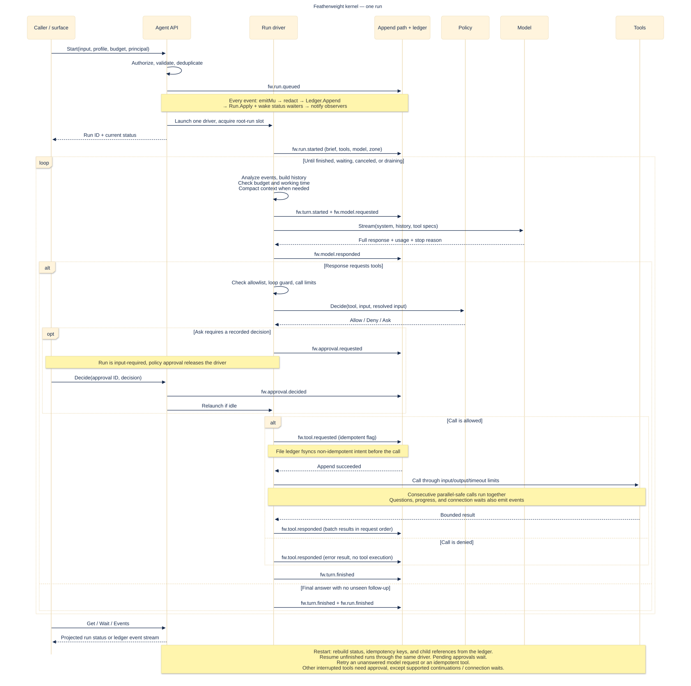

# Kernel architecture map

Source survey of `featherweight-kernel` at `b0b998c`, 2026-10-18. These diagrams describe the implementation in this checkout. The scope is one kernel process and its external interfaces. The detailed design is in [ARCHITECTURE.md](ARCHITECTURE.md).

**The kernel is a ledger-driven agent runtime.** An `Agent` owns profiles, drivers, and runs. Each run has one active driver that derives its next action from recorded events. Models and tools act through interfaces; one serialized append path records the results and updates the read models.

## 1. Components


[Open full-size SVG](diagrams/kernel-components.svg) · [Editable Mermaid](diagrams/kernel-components.mmd)

Arrows show calls or data flow, not Go imports. Dotted arrows show composition, recovery, or optional paths. The boxes name packages and runtime responsibilities; drivers run in the same process and call external services where indicated.

### Composition and boundaries

- **Assembly:** [`cmd/fw/drivers.go`](../cmd/fw/drivers.go) and `driver_*.go` select packages. Drivers register constructors in `init`; [`fw.New`](../fw/agent.go) resolves interfaces and starts the runtime. Build tags select optional drivers.
- **Configuration:** [`config/`](../config/config.go) loads defaults, YAML, `FW_*` overrides, and profiles. CLI overrides follow the environment. Go callers can inject implementations with `fw.With*` options.
- **Inbound access:** native and A2A operation routes use `Authn`, then the Agent API applies `Authz` to principal-bearing requests. Token, OIDC, SPIFFE, and explicit anonymous modes are implemented. The A2A card, health, and metrics routes are public. Bus intake is a trusted process channel.
- **Execution policy:** `Authz` controls callers; `Policy` controls model tool calls. Profile and ancestor rules can tighten tool policy. An external MCP or bus decision point can supply the base policy.
- **Extensions:** registries, services, observers, annotators, tool environment hooks, prompt sections, `native.Extend`, `PersonTokens`, `Spawner`, `Forker`, and `Runner` are the integration points. The package `env` uses the hooks for packages on the durable volume, and a `Runner` drives the runs in place of the turn loop: the package `harness` hosts opencode and Claude Code with it (both added 2026-10-20). The token broker is an external service in this map. The kernel contains its client and the pause/resume primitive.
- **Dependency direction:** public driver packages import `fw`; `fw` imports no driver. It does import `gopkg.in/yaml.v3` for configuration types, so the current package is not strictly standard-library-only.

### Source map

| Responsibility | Source and key symbols |
|---|---|
| Binary and command modes | [`cmd/fw/main.go`](../cmd/fw/main.go), [`cli/cli.go`](../cli/cli.go): `Run`, `newAgent` |
| Composition and public contracts | [`fw/agent.go`](../fw/agent.go): `New`, `Agent`; [`fw/registry.go`](../fw/registry.go): `Register*`; [`fw/options.go`](../fw/options.go) |
| Run API and serialization | [`fw/kernel.go`](../fw/kernel.go): `Start`, `Send`, `Decide`, `Cancel`, `runState`, `runDriver`, `appendLocked` |
| Execution and safeguards | [`fw/turn.go`](../fw/turn.go): `analyze`, `drive`, `stepModel`, `stepTools`, `runBatch`; [`fw/limits.go`](../fw/limits.go), [`fw/clock.go`](../fw/clock.go), [`fw/compact.go`](../fw/compact.go) |
| Prompt, profile, and skill assembly | [`fw/prompt.go`](../fw/prompt.go), [`fw/profiles.go`](../fw/profiles.go), [`fw/skills.go`](../fw/skills.go); `stepStart` records tool briefs |
| Persistence and read models | [`fw/ledger_file.go`](../fw/ledger_file.go): `FileLedger`; [`fw/mem.go`](../fw/mem.go); [`fw/projection.go`](../fw/projection.go): `ProjectRun`, `ProjectHistory`, `historyBuilder` |
| Recovery, replay, and branching | [`fw/resume.go`](../fw/resume.go): `rebuild`, `resume`; [`fw/replay.go`](../fw/replay.go); [`fw/fork.go`](../fw/fork.go) |
| Models and tools | [`model/`](../model/); [`tools/builtin/`](../tools/builtin/), [`tools/mcp/`](../tools/mcp/), [`tools/a2a/`](../tools/a2a/) |
| Memory (section 7.8) | [`fw/memory.go`](../fw/memory.go): `Memory`, `MemoryWriter`, `MemoryScope`, `RecordMemoryChange`; [`fw/runcontext.go`](../fw/runcontext.go): `ContextBriefer`, `ContextBlock`; [`memory/`](../memory/): `Store` (notes, scopes, limits, audit, recall, FTS5 index under the tag `memory_sqlite`); [`tools/builtin/memory.go`](../tools/builtin/memory.go), [`tools/builtin/recall.go`](../tools/builtin/recall.go); [`surface/native/memory.go`](../surface/native/memory.go): `/v1/memory` |
| Workspace and attachments | [`fw/files.go`](../fw/files.go): `Files`, `DirFiles`; [`fw/workspace.go`](../fw/workspace.go); [`fw/attach.go`](../fw/attach.go) |
| Authentication and authorization | [`fw/surface.go`](../fw/surface.go): `RequireAuth`; [`fw/authz.go`](../fw/authz.go); [`authn/oidc/`](../authn/oidc/), [`authn/spiffe/`](../authn/spiffe/). [`fw/actingfor.go`](../fw/actingfor.go) holds `WithActingFor` and `ActingFor`, the person that a trusted relay names. |
| Tool policy and external decisions | [`fw/policy.go`](../fw/policy.go), [`fw/external.go`](../fw/external.go), [`tools/mcp/decision.go`](../tools/mcp/decision.go) |
| Transport surfaces and shared views | [`surface/native/`](../surface/native/), [`surface/a2a/`](../surface/a2a/), [`surface/view/`](../surface/view/) |
| Queue intake and event egress | [`fw/intake.go`](../fw/intake.go): `handleIntake`, `intakeGate`, `settleJob`; [`fw/busio.go`](../fw/busio.go): `egress`; [`bus/nats/`](../bus/nats/), [`bus/redis/`](../bus/redis/) |
| Observability | [`surface/metrics/metrics.go`](../surface/metrics/metrics.go); [`telemetry/metrics.go`](../telemetry/metrics.go): `Attach`; [`telemetry/otlp.go`](../telemetry/otlp.go): `Export` |
| Package environments (section 18) | [`env/`](../env/): `Start`, `toolEnv`, the tool `env`, `section`; [`fw/toolenv.go`](../fw/toolenv.go): `RegisterToolEnv`, `ExtendToolEnv`; [`fw/prompt.go`](../fw/prompt.go): `RegisterPromptSection`; [`cli/env.go`](../cli/env.go): `fw env dockerfile` |
| Child execution and credentials | [`fw/spawn.go`](../fw/spawn.go): `SpawnChild`, `Spawner`, `Forker`; [`ax/spawn.go`](../ax/spawn.go); [`fw/connect.go`](../fw/connect.go); [`tokens/tokens.go`](../tokens/tokens.go) |
| Check runs (section 23 of the design) | [`fw/check.go`](../fw/check.go): `Check`, `stepCheck`, `checkTool`, `CheckOutput`. The calls take `routineRun.call` of [`fw/routine_run.go`](../fw/routine_run.go). `view.FilterKind` leaves them out of the lists (added 2026-10-23). |
| Hosted harnesses (section 19 of the design) | [`fw/runner.go`](../fw/runner.go): `Runner`, `RegisterRunner`, `WithRunner`, `Hosted`, called first by `driverBody`; [`harness/`](../harness/): [`core.go`](../harness/core.go) (ledger scan, turns, files, policy, budget), [`opencode.go`](../harness/opencode.go), [`claudecode.go`](../harness/claudecode.go) (and its hook route on the native API) |

## 2. Run execution and durability



[Open full-size SVG](diagrams/kernel-run.svg) · [Editable Mermaid](diagrams/kernel-run.mmd)

The sequence shows the main answer/tool paths. Refusal, output-token continuation, context-overflow retry, cancellation, and shutdown also flow through the same driver and append path.

### What owns state

1. **Run history:** the ledger is the authoritative event record. The default driver writes `$FW_HOME/runs/<id>/ledger.jsonl` and a run index. Approvals, terminal events, and non-idempotent tool intents trigger `fsync`. A failed intent append prevents the tool body from running.
2. **Runtime projections:** `Run.Apply` maintains status, usage, metadata, and pending approval state. `historyBuilder` incrementally constructs model messages. `analyze` derives the execution cursor from the events. These are core data structures, not separately registered observers.
3. **Other file state:** workspace contents, attachment bytes, memory notes, skills, and configuration live in files. The ledger records file references and change metadata, not a versioned copy of the workspace. File operations through `fw.Files` emit change events; shell writes do not.
4. **External effects:** a successful local append does not make a remote tool effect exactly-once. Recovery uses recorded intent, results, idempotency, and approvals to choose the next action.

### Concurrency and recovery

- `runState.active` admits one driver per run. `runState.emitMu` serializes appends from the driver, API methods, and tool callbacks. The design document's mailbox is a conceptual model; the implementation has no distributed mailbox or run lease.
- `maxRuns` limits root-run drivers: 16 when unset outside ax, and 1 by default under ax. Local children bypass that semaphore so a waiting parent cannot block its children. Spawn depth and child-count limits bound delegation.
- Consecutive `ParallelSafe` tool calls run together. Their results are recorded in request order after the batch joins. Tool progress and questions can append while calls run.
- Policy approvals make the driver idle. Questions and connection requests inside a running tool wait on a decision channel. Both kinds of wait are represented by approval events.
- Startup rebuilds run status, idempotency keys, and child references. The driver reloads history when it runs. An unanswered model request is retried; an interrupted idempotent tool can run again. Other interrupted tools ask for approval, with explicit exceptions for `Continuer` tools and calls that were waiting for a connection.
- A follow-up can reopen a finished run. `Fork` copies a ledger prefix into a new run. A local branch shares the process workspace, and with `tools.files.perRun` the directory of its source; a remote branch uses a `Forker`. Replay supplies recorded tool results matched by tool name and JSON arguments.

### Events leaving the process

- Native SSE, A2A task streams, and CLI event output read or watch the ledger. The current model call uses `Model.Stream`, but `stepModel` discards deltas and records the full response. These surface streams are event streams, not live token streams.
- Observers receive new events after the append and status update. They are synchronous callbacks and must return quickly. Startup does not replay all historical events to every observer. Metrics seed open-run state when attached; historical counters are not rebuilt.
- Bus intake takes a job only for a free `maxRuns` slot (`fw.GatedBus`) and acknowledges it once `fw.run.queued` is synced to the ledger; it never waits for the run. A failed job goes back on the queue up to `bus.intakeRetries` times and then to `<intake>.dead`, as does a request that cannot start (updated 2026-10-20). With the file ledger, egress reads the ledger after a cursor per run and route (`fw.EgressCursors`, files under `<ledger>/.egress/`), so an event that the bus did not confirm goes out at the next boot: at least once, never skipped (updated 2026-10-20). A ledger without cursors, such as the memory ledger, keeps the old ordered queue in memory, capped at 10,000 events, which overflow or process loss can lose.
- The metrics surface exposes Prometheus. The `telemetry.Export` service sends configured OTLP metrics, event logs, and traces. Metrics export waits for the metrics surface to mount.

## 3. Deployment inside ax



[Open full-size SVG](diagrams/kernel-ax.svg) · [Editable Mermaid](diagrams/kernel-ax.mmd)

The same runtime also runs as a plain process, a container, or an embedded library. The ax-specific shell around it is in [`cli/serve.go`](../cli/serve.go), [`ax/`](../ax/), [`ax/guest/`](../ax/guest/), and [`surface/axmeta/`](../surface/axmeta/).

The implemented boot order is:

1. Read and stash Task and Workspace manifests; start the PID 1 reaper.
2. Open the shared listener with a boot handler: healthy, not ready. Start loopback metadata and optional debug guest services.
3. Prepare workspace bindings and honor saved initialization markers.
4. Load configuration and merge the Task and Workspace settings.
5. Construct `fw.Agent`. Construction rebuilds and resumes runs, starts bus intake/egress, and then starts registered services.
6. Run bootstrap goals, mount the agent handler, and mark the listener ready.
7. Serve, run an in-process `fw` command or `FW_GOAL`, or supervise `spec.command`.

With `spawn.driver: ax`, the spawner creates and resumes a child Task through the ax gRPC API, then starts and follows its run through the atenet router. Remote forks use `Place` followed by `Branch`. The parent ledger records remote child references. Local children keep the parent's principal and bounded permissions; remote requests carry the constrained tool set, rules, budget, and identity. Remote spawning with custom or external tool policy is refused because that policy cannot be transferred by the current protocol.

Under the documented Substrate suspend contract, `/workspace` is snapshotted and restored into a fresh container. Recovery therefore depends on the ledger and files included in that snapshot. A graceful process shutdown instead drains work, records suspension for working runs, and flushes the ledger. Snapshot restore and graceful shutdown are distinct paths.

## 4. Implementation notes from the survey

These details qualify the broader design in `ARCHITECTURE.md`:

| Area | Current implementation |
|---|---|
| Ledger drivers | `file` and `mem`. NATS and Redis register **bus** drivers; this checkout has no NATS, Redis, or SQLite ledger driver. |
| Per-run mailbox | One active driver plus serialized event appends inside a process. A shared ledger does not provide cross-process run ownership. |
| Projections | Core status/history structures are rebuilt from events. Observers receive new appends; they do not all replay history at boot. |
| Model streaming | Provider adapters stream internally. The kernel records a completed response rather than forwarding token deltas to surfaces. |
| AX children | Implemented in `ax/spawn.go`, including remote branches. The early delivery checklist predates this implementation. |
| AX readiness | Resume happens during Agent construction, before bootstrap goals finish and before the agent handler becomes ready. |
| Authentication | Both OIDC bearer verification and SPIFFE are kernel drivers. Browser sign-in is a separate integration. |
| A2A push configuration | Held in memory by the A2A surface; not persisted in the run ledger. |
| Core dependencies | Driver-independent, with a YAML dependency in `fw/config.go`. |

## Editing the diagrams

The `.mmd` files are the editable sources. The `.svg` files are rendered copies that display without Mermaid support. From the repository root, render them with Mermaid CLI 12.0.0:

```sh
for name in kernel-components kernel-run kernel-ax; do
  npx --yes --package=@mermaid-js/mermaid-cli@12.0.0 mmdc \
    -i "docs/diagrams/$name.mmd" \
    -o "docs/diagrams/$name.svg" -b white
done
```
